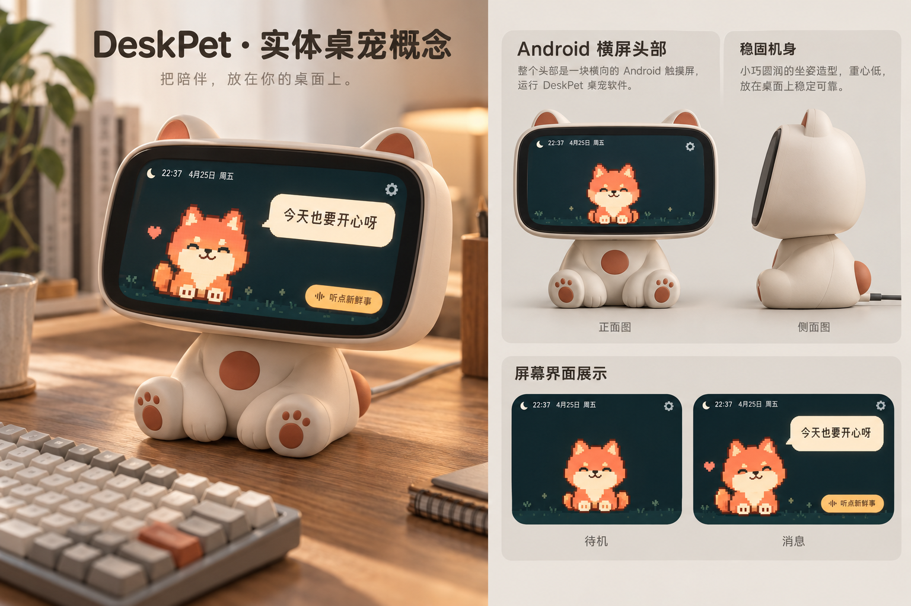

# 实体桌宠与 Android 屏幕界面

更新日期：2026-10-24。项目入口见 [文档索引](../README.md)，源码位置见 [项目结构](../project-structure.md)。

这是一版外观概念：圆润坐姿机身，头部正面为横向 Android 触摸屏，后部接电。图中外壳、尺寸比例和示例角色仅供讨论，不是可直接生产的结构模型、CAD 或硬件规格。图中的时钟和装饰场景属于概念效果，当前软件继续使用项目已有的基尔兽动画。

## 已实现的界面

- 固定横屏和沉浸式全屏；应用在前台时保持屏幕亮起，适合桌面持续展示。
- 深青色背景和暖色按钮，缩小顶部名称、状态和设置入口。
- 待机时宠物居中；消息出现时左侧显示宠物，右上角显示奶油色气泡。关闭后恢复居中。
- 气泡限制在剩余屏幕范围，长内容内部滚动，新消息从顶部显示，保留关闭和反馈。
- “听点新鲜事”按钮已隐藏，通过双击宠物获取热点；请求期间阻止重复触发，顶部显示加载状态。
- 支持键盘 Enter / 空格触发，保留焦点提示；设置表单可在横屏内滚动。
- 对小于 400px、320px 高度的屏幕缩小宠物和留白，并保留至少 44px 的触摸按钮。

## 验证

`node scripts/test-pet-ui.cjs`、`node scripts/test-bubble-ui.cjs` 和 `node --check crates/deskpet-app/frontend/mobile.js` 已通过。覆盖单击入口、双击防重入、加载状态、消息滚动复位、键盘触发、情绪复位和桌面气泡阅读行为。

本次未完成实际 Android 设备与浏览器多尺寸截图验收，也未生成新 APK。硬件屏幕尺寸、分辨率和边框遮挡范围确定后，应在目标设备上检查显示比例、可读性与亮度。

可选本地模拟预览：若本机存在 `.tools/preview-companion.cjs`，可在项目根目录执行 `node .tools/preview-companion.cjs`，浏览器访问 `http://127.0.0.1:4173`。该预览使用模拟数据，不读取密钥，不调用模型。`.tools/` 被 Git 忽略，该脚本不是其他机器构建必需文件；预览不能替代 Android 真机验证。

## 概念图生成

使用内置 imagegen 工具生成。完整提示词见 [生成提示词](deskpet-physical-concept.prompt.txt)。图片为本项目保存的概念参考，未作为软件运行时资源引入。
