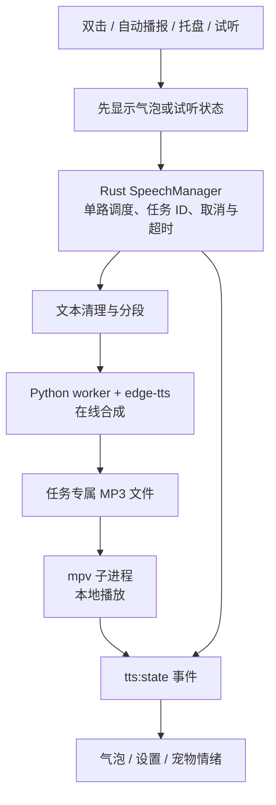

# Windows Edge TTS 语音输出设计方案

更新日期：2026-10-24。状态：设计，尚未实施。适用项目根目录：`desktop_app/`。

当前实施说明：Windows GUI 已按后续用户要求接入，复用已有音色和开关，不增加试听入口；合成/播放期间气泡保持，主动关闭停止语音。以下为早期完整设计候选，实际能力、路径与验证以 [接入记录](windows-edge-integration-plan.md) 为准。

后续进度：独立 [语音 Demo](../demos/edge-tts/README.md) 已验证在线合成与浏览器播放，主程序尚未集成。渐进实施顺序、现有代码风险和回退边界见 [主项目接入方案](windows-edge-integration-plan.md)。

本方案确定 Windows 首版采用 Edge TTS 在线合成与 mpv 本地播放，替代此前 Windows 原生语音优先的建议；Android 原生 TTS 计划单独保留。本轮只修改设计文档，不安装依赖、不发送实际文本、不修改业务代码。

## 1. 目标与范围

- 模型回复或真实热点模板文案出现后自动朗读；先显示气泡，语音异步开始。
- 用户可以停止、重播、试听，调整音色、语速与音量。
- 全应用单路播放，手动操作优先，取消后不再播放旧结果。
- 分发版本随包携带合成运行时和播放器，普通用户无需安装 Python 或配置 PATH。
- 不增加麦克风权限，不包含语音输入、唤醒词、声音克隆和后台音频服务。

Edge TTS 使用 Microsoft Edge 的在线语音服务。上游提供 Python API、音色列表与语速/音量/音调参数，通常不需要单独申请语音 API Key；本方案不承诺服务持续可用或离线合成。[上游文档](https://github.com/rany2/edge-tts/blob/master/README.md)

## 2. 现有代码与需要修正的问题

| 位置 | 当前行为 | 设计调整 |
| --- | --- | --- |
| `crates/deskpet-tts/src/lib.rs` | 只有 `TtsProvider::speak` | 拆分合成、播放与统一任务管理，支持取消、状态和错误 |
| `crates/deskpet-tts/src/edge_tts.rs` | 调外部 CLI，合成后寻找 mpv/ffplay/cvlc | 固定一个可管理的合成 worker 和 mpv 播放后端 |
| 同上 | 无播放器时仍返回成功，忽略播放器执行结果 | 无播放器、非零退出和解码失败必须返回明确错误 |
| 同上 | 部分失败路径可能遗留临时文件，没有超时或停止 | 任务目录统一清理，持有子进程句柄，超时/取消终止进程 |
| `crates/deskpet-app/src/runtime.rs` | 启动时创建 TTS，播放失败只写日志 | 启动语音管理器；错误可查询、可回传，配置可更新 |
| `crates/deskpet-app/src/gui.rs` | 自动/托盘先等语音，再显示气泡 | 展示气泡后提交独立语音任务 |
| `crates/deskpet-app/src/ipc.rs` | 双击未朗读，`tts_speak` 总是返回成功 | 双击接通统一入口，返回任务受理结果，完成状态通过事件报告 |
| `frontend/settings.*`、`bubble.html` | 基础语音设置，无完整播放控制 | 增加试听、停止、重播、引擎检测与当前状态 |

当前 `trigger_agent` 无热点候选时还可能调用 `idle_reply()` 返回自然回应。实施时应明确区分“可朗读的自然回应”和“刷新中/失败提示”，不能只按是否存在热点 ID 判断是否朗读。

## 3. 系统结构



模块按职责拆分，避免 `speak()` 同时负责网络、临时文件、播放和 UI：

| 拟新增或调整的位置 | 职责 |
| --- | --- |
| `crates/deskpet-tts/src/manager.rs` | 语音任务、优先级、取消、状态机、配置快照 |
| `crates/deskpet-tts/src/edge_tts.rs` | 启动合成 worker，接收结构化结果，检查文件 |
| `crates/deskpet-tts/src/player.rs` | mpv 启动、退出状态、音量与进程回收 |
| `crates/deskpet-tts/src/text.rs` | 清理链接/标记，按句分段及长度检查 |
| `crates/deskpet-app/resources/tts/edge_worker.py` | 使用固定版本 edge-tts，提供合成/音色查询的 JSON 协议 |
| `crates/deskpet-app/src/runtime.rs` | 持有管理器，向 GUI/headless 提供统一入口 |
| `crates/deskpet-app/src/config.rs`、`settings.rs` | 配置默认值、校验、旧配置兼容与热更新 |
| `crates/deskpet-app/src/ipc.rs`、`gui.rs` | 命令、事件、各播报入口接入 |
| `crates/deskpet-app/frontend/bubble.html`、`settings.*` | 播放控制、试听与错误提示 |
| `crates/deskpet-app/tauri.conf.json` | 增加受版本管理的运行时资源打包配置 |

以上为拟议路径，不表示这些文件已经存在。不编辑 `target/` 或 Android 构建输出实现 Windows 功能。

## 4. 合成与播放方式

### 4.1 合成 worker

首版使用 Python `edge-tts` 库，不在 Rust 中自行重写服务协议。每个合成任务启动一个短生命周期 worker，进程内对各段顺序合成，完成后退出；便于取消、升级和隔离异常。

- Rust 通过标准输入发送 JSON，包含任务 ID、音色、语速、音调、分段文本与输出目录。
- worker 通过标准输出返回 JSON 结果；诊断写标准错误，不混入协议输出。
- 音色查询使用 Python `list_voices()` 转成结构化 JSON，不解析 CLI 的展示表格。
- 使用当前 `zh-CN-XiaoxiaoNeural` 作为初始候选，最终按在线查询和试听验证可用性；不得静默替换用户音色。
- 文本不会拼入 shell 命令。Rust 直接启动已解析的绝对路径进程并传递独立参数，子进程隐藏窗口。
- MP3 先写入任务专属临时文件，成功且非空后改为可播放文件；失败文件不能进入播放器。

开发排障可以使用上游 `edge-tts` CLI。应用正式协议采用 worker，以稳定返回音色列表和错误。

### 4.2 mpv 播放

首版只使用 mpv，不再随机寻找多个播放器。mpv 支持 JSON IPC，可作为后续精细播放控制的扩展点。[mpv 文档](https://mpv.io/manual/stable/)

- 每次播放启动一个无视频、无终端交互的子进程，并禁用自动加载用户配置/脚本，使行为可重复。
- Rust 保存进程句柄，检查启动与退出状态；停止时终止对应播放器并等待退出。
- 每段播放成功后才能进入下一段；任何段播放失败都结束本次任务并反馈。
- 音量 0～100 映射到播放器，合成音量保持默认，避免叠加两套音量控制。
- 首版设置变化作用于下一次播放；关闭语音立即取消当前任务。无需首版实现播放中动态调音量或暂停续播。

上游 `edge-playback` 在 Windows 上不强制依赖 mpv。这里选用 mpv 是项目的控制和分发选择，不是 Edge TTS 本身的强制要求。[上游说明](https://github.com/rany2/edge-tts/blob/master/README.md)

## 5. 播报流程与状态

1. 业务生成回复，分配 `announcement_id` 并显示气泡。
2. 检查语音开关及内容类型，创建 `speech_id`；无 Key 的模板回复也允许朗读。
3. 清理朗读文本，按标点分段并保留原顺序；气泡正文保持完整。
4. 进入 `synthesizing`，顺序合成并缓存本任务所有分段，首版不做流式边合成边播放。
5. 合成完成且任务仍有效时进入 `playing`，mpv 按段播放。
6. 成功后进入 `completed`；取消进入 `cancelled`；失败进入 `failed`。
7. 清理临时文件并释放句柄；恢复宠物状态。

状态集合：`disabled / idle / synthesizing / playing / completed / cancelled / failed`。启动检测状态与播放状态分开，依赖存在不等于在线合成一定成功。

每个状态事件携带 `speech_id`、`announcement_id`、单调递增序号、阶段和可选错误码；前端忽略旧任务或旧序号事件。恢复或新打开窗口时查询当前状态，避免丢失事件。

取消必须覆盖合成进程和播放进程：Windows 用任务专属 Job Object 管理后代进程，等待退出后再清理文件。不能只丢弃 Rust future 或 `JoinHandle`，也不能只依赖 `kill_on_drop` 终止整个进程树。网络等待期间不持有全局状态锁。

## 6. 触发规则与界面

| 场景 | 语音行为 |
| --- | --- |
| 双击生成新热点回复 | 立即显示文字，再朗读；新手动请求取消旧朗读 |
| 无新热点后的自然回应 | 标记为自然回应时可朗读；固定空结果提示不朗读 |
| 自动播报、托盘播报 | 走同一个管理器；自动触发仍遵守现有勿扰策略 |
| 正在朗读时又有自动候选 | 不打断，不产生自动语音积压；不改变业务已有的候选去重语义 |
| 设置试听 | 用户显式触发，取消当前语音；使用固定短句和当前待保存的合法参数，不保存配置 |
| 关闭或反馈气泡 | 停止该气泡关联语音；保留原反馈行为 |
| 点击停止 | 只取消指定任务；迟到的旧气泡停止请求不得取消新任务 |
| 点击重播 | 用户显式请求，取消当前语音，重新朗读当前内容；不重复写热点播报记录 |
| 关闭语音、退出应用 | 取消全部当前任务和等待任务，回收子进程 |
| 刷新中、错误、固定无候选状态 | 只显示文字，不朗读 |

Windows 气泡底部增加“停止/重播”和状态文字，长正文滚动布局保持。合成或播放期间暂停气泡自动隐藏；完成后重新开始阅读计时。没有语音时保留原有鼠标/焦点阅读计时。

设置页显示：语音开关、在线音色列表、语速、音调、音量、试听、停止与依赖检测。明确显示“在线语音”。隐藏的“听点新鲜事”按钮不恢复。

现有临时情绪的 8 秒恢复计时需要与播放状态协调，避免旧任务完成事件覆盖新情绪。首版不承诺精确口型或音素同步。

## 7. 配置与 IPC 草案

以下为新增配置设计，不是当前代码已经支持的字段：

```toml
[tts]
provider = "edge"
enabled = true
voice = "zh-CN-XiaoxiaoNeural"
rate_percent = 0         # 应用允许 -50～100
pitch_hz = 0             # 应用允许 -50～50
volume = 80              # 本地播放器音量 0～100
synthesis_timeout_sec = 30  # 每段超时
total_timeout_sec = 90      # 本次合成总超时
playback_timeout_sec = 300  # 整次朗读最长时间
max_chars = 2000         # 超限保留文字，提示不自动朗读
```

上述取值为本产品约束，不是上游参数范围。单段目标约 200～300 字，优先按句分段；超限不静默裁剪。语速/音调映射到上游的百分比/Hz 字符串。[参数说明](https://github.com/rany2/edge-tts/blob/master/README.md#changing-rate-volume-and-pitch)

旧配置继续读取 `provider/voice/enabled`，新增字段使用默认值；保留原开关与音色。每个任务使用不可变配置快照，新设置用于下一任务，避免任务中途混用参数。

拟议命令：`tts_check`、`tts_list_voices`、`tts_preview`、`tts_replay`、`tts_stop`、`tts_get_state`。启动播放命令返回 `{speech_id, accepted}`，仅表示受理；实际成功由 `tts:state` 终态确认。`tts_stop` 必须携带目标任务 ID。

## 8. 超时、失败与临时数据

- 可重试的网络合成失败最多重试一次，退避约 1 秒，受整次合成总预算约束；参数错误、缺依赖与用户取消不重试。
- 首版不自动切换另一家服务或音色；失败保留气泡并提示“语音暂不可用”，用户可重播。
- 错误码区分 `dependency_missing`、`network_error`、`voice_unavailable`、`synthesis_timeout`、`invalid_audio`、`playback_failed`、`playback_timeout`、`cancelled`。
- 每次任务使用独立目录。完成、失败、取消都清理；启动时仅清理本应用语音目录内的过期残留，不能清空整个系统临时目录。
- 音色列表缓存 24 小时，失败时可显示标注为旧数据的列表；试听仍验证真实在线可用性。
- 首版不持久缓存朗读音频，不在日志记录完整朗读文本。在线合成会将待朗读文本发送到语音服务，设置页说明这一点。
- 播放器正常结束只说明播放流程完成，不能证明扬声器实际可听；设备静音、音量和输出设备需要试听确认。

## 9. 依赖与打包

开发阶段安装锁定版本的 Python、edge-tts 和 mpv，先完成命令行合成及播放烟测；正式版本不要求用户自行安装。

```text
crates/deskpet-app/resources/tts/       # 拟新增的资源逻辑布局
├── edge_worker.py
├── python/                           # 固定版本的 Windows 私有运行时及依赖
├── mpv/                              # 固定版本的播放器及必要依赖
└── runtime-manifest.json              # 平台、版本、校验信息
```

Tauri 构建资源映射保留该布局，运行时通过资源目录解析绝对路径，不能依赖开发机 PATH 或工作目录。先交付 Windows x64，其他架构单独构建验收。Python、edge-tts、播放器及依赖固定版本，随分发包保留相应许可材料。

版本检查必须验证进程成功退出，不能只检查“进程启动成功”。在线音色查询和试听分开检查；应用启动不自动安装包或访问包管理源。离线能启动应用、查看文字，但不能生成新的 Edge TTS 音频。

## 10. 实施与验收

| 阶段 | 工作 | 预计单人工作日 | 验收 |
| --- | --- | --- | --- |
| A | Windows 依赖与中文合成播放烟测、固定版本 | 0.5～1 | 指定音色合成 MP3 并真实播放 |
| B | worker、播放器、状态机、取消与超时 | 1.5～2 | 网络失败、取消、播放失败均有正确终态；无残留进程 |
| C | 双击/自动/托盘统一入口，气泡停止和重播 | 1～1.5 | 文字先显示；不叠音、不播放旧结果 |
| D | 设置、试听、音色列表、配置迁移与热更新 | 1～1.5 | 老配置可读；试听与已保存配置互不覆盖 |
| E | 资源打包、干净机器安装与异常回归 | 1～2 | 无预装 Python/mpv 的机器可运行；断网正确降级 |

总计约 5～8 个工作日，不含目标环境、依赖下载和在线服务故障造成的等待。先文件合成后播放会有首声等待，首版不承诺流式首声延迟；稳定后再考虑边合成边播放。

必须覆盖：中文及混合标点、长文本、无播放器、空音频、合成/播放非零退出、断网、超时、快速重复触发、取消发生在合成或播放中、迟到回调、关闭气泡、应用退出、旧配置升级和中文/空格安装路径。

验证分为模拟测试、联网烟测、实际听音和安装验收；四者分别记录。代码存在、文件生成或进程正常退出不能替代最终听音验收。

## 11. 后续扩展

- 流式音频与更低首声等待，验证合成失败后半段和播放缓冲的处理。
- 基于同一 MP3 的临时重播缓存，配置变化后正确失效。
- Android 若未来也使用 Edge 音色，需要独立设计服务端合成接口或经过验证的移动端适配；不将 Windows Python/mpv 方案直接搬入 Android。
- 使用同一 SpeechManager 接入其他语音提供方，但 Windows 首版不混入多个后端。

与总体计划的关系见 [语音输出实施计划](voice-output-plan.md) 和 [路线图](roadmap.md)。
